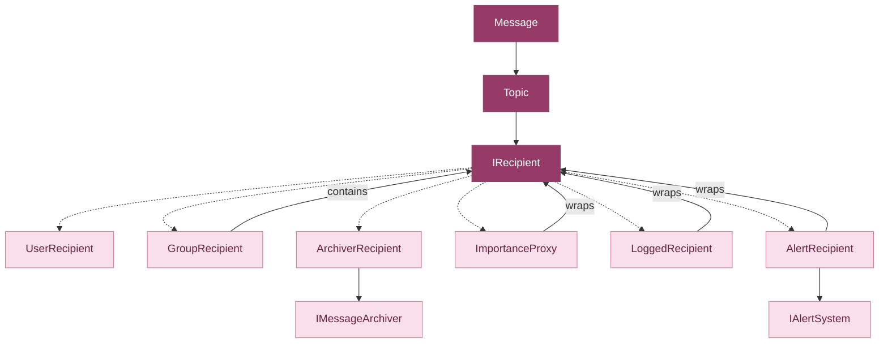

<p align="center">
  
</p>

<p align="center">
  
  
  
  
  
</p>

# Corporate Messaging System

## ✧ О проекте

Библиотека на C# для моделирования корпоративной доставки сообщений. Позволяет настраивать маршрутизацию по темам и группам получателей, фильтровать сообщения по приоритету и подключать дополнительные механизмы обработки без изменения основной логики доставки.

## ✧ Функциональные возможности

- Рассылка сообщений отдельным получателям и группам через именованные темы.
- Хранение полученных сообщений и индивидуального статуса прочтения.
- Фильтрация по минимальному уровню важности и логирование доставки.
- Архивирование в памяти и передача форматированного текста в абстракцию вывода.
- Подготовка Markdown-текста и форматирование для консоли.
- Текстовые оповещения и интерфейс звукового сигнала; запуск оповещения по ключевым словам или для каждого сообщения.

## ✧ Архитектура

Маршрутизация опирается на общий контракт `IRecipient`. Поведение получателей расширяется посредством композиции и обёрток. Архиваторы, форматтеры и системы оповещений подключаются через интерфейсы.



## ✧ Паттерны проектирования

| Паттерн | Применение |
| --- | --- |
| Composite | `GroupRecipient` объединяет получателей под общим интерфейсом. |
| Proxy | `ImportanceProxy` контролирует передачу по уровню важности. |
| Decorator | `LoggedRecipient` и `AlertRecipient` расширяют обработку сообщения. |
| Adapter | `ArchiverRecipient` связывает контракт получателя с архиватором. |
| Dependency Injection | Зависимости передаются через конструкторы, что упрощает подмену компонентов в тестах. |

## ✧ Пример использования

```csharp
using CorporateMessaging.Messages;
using CorporateMessaging.Recipients;
using CorporateMessaging.Topics;

var inbox = new UserRecipient();
var topic = new Topic("Engineering");
topic.AddRecipient(new ImportanceProxy(inbox, Importance.Medium));

var message = new Message("Release", "New version is available.", Importance.High);
topic.Send(message);
inbox.MarkAsRead(message);
```

## ✧ Структура проекта

```text
src/CorporateMessaging/
├── Alerts/          # Оповещения
├── Archivers/       # Архивирование
├── Formatters/      # Форматирование
├── Infrastructure/ # Абстракции вывода
├── Messages/       # Модель сообщения
├── Recipients/     # Получатели и обёртки
└── Topics/         # Маршрутизация сообщений

tests/CorporateMessaging.Tests/  # Автоматические тесты и test doubles
```

## ✧ Сборка и тестирование

Требуется .NET SDK 9.0 (для файла решения `.slnx` — 9.0.200 или новее в ветке 9.0).

```bash
dotnet restore CorporateMessaging.slnx
dotnet build CorporateMessaging.slnx
dotnet test CorporateMessaging.slnx
```

В проекте семь тестов xUnit: проверка статусов прочтения, фильтрации, логирования, форматирующего архиватора и маршрутизации. Для изоляции зависимостей используются собственные тестовые двойники (fake-объекты).

> Проект представляет собой библиотеку классов, а не самостоятельное CLI- или веб-приложение. Отдельная реализация записи в файл и конкретный адаптер звукового сигнала в текущей версии отсутствуют.

*Учебный проект по объектно-ориентированному программированию и проектированию ПО.*


